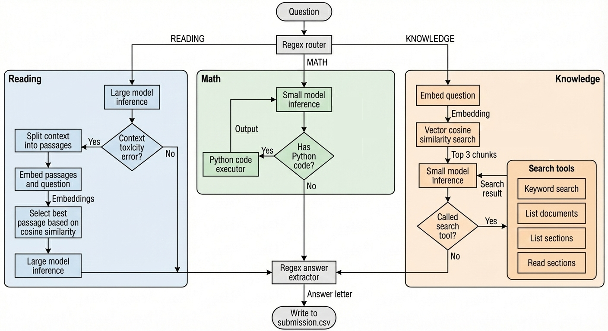

# Agentic RAG System

A system combining LLMs with RAG and tool calling to answer multiple-choice questions across reading comprehension, mathematics, and knowledge-based domains.

Submission for Track 2 of the [VNPT AI Hackathon – Age of AInicorns](https://vnptai.io/age-of-ainicorns)

## Quick Start

### Set Environment Variables

Create a `.env` file from the example template:

```bash
cp .env.example .env
```

Fill in the following environment variables in `.env`.

### Build Docker Image

Pull the Docker image:

```bash
docker pull lengvietcuong/vnpt-ai
```

Or, build the Docker image locally:

First, download `data.dump` from this [link](https://drive.google.com/file/d/1CLElB17zxTqdHq_ZdeNpSy282fGkNtE7/view?usp=sharing) and place it in the `data/` directory.

Then, run the build command:

```bash
docker build . -t vnpt-ai
```

### Run Docker Container

Run the Docker container with the following command:

```bash
docker run \
  --mount type=bind,source="$(pwd)/private_test.json",target=/code/private_test.json \
  --mount type=bind,source="$(pwd)/submission.csv",target=/code/submission.csv \
  --mount type=bind,source="$(pwd)/.env",target=/code/.env \
  vnpt-ai
```

> **Important**: Replace `$(pwd)/private_test.json` and `$(pwd)/submission.csv` with the actual paths on your host machine if needed. The `submission.csv` file must exist before running the container.

## Pipeline

### Architecture Overview

[](flowchart.png)

### Process Flow

#### 1. Question Classification

The system uses a regex-based router to classify each question into one of three categories:

- **READING**: Questions containing long passages
- **MATH**: Questions requiring calculations in math, physics, chemistry, or economics
- **KNOWLEDGE**: Questions requiring knowledge retrieval

#### 2. Question Processing

**READING**

- Passed directly to the LLM for 0-shot inference
- If inference fails (e.g., due to toxic content in passages), the system employs a retry strategy:
  1. Split the context into individual passages
  2. Embed each passage and the question
  3. Select the most relevant passage
  4. Retry inference

**MATH Questions**

- The model's response is prefilled with ` ```python\n` to encourage code generation
- Code is executed via a Python executor
- The output (or error message) is fed back to the model
- This iteration continues until the model determines the final answer

**KNOWLEDGE Questions**

- The question is embedded using the embedding model
- Vector cosine similarity search retrieves the top 3 most relevant chunks from the PostgreSQL database (with pgvector extension). Retrieved chunks are added as context to the LLM prompt
- The model has access to four tools defined in `src/config.py`:
  - `keyword_search`: Full-text search with semantic reranking
  - `list_documents`: List available documents by topic
  - `list_sections`: List sections within documents
  - `read_sections`: Read specific document sections
- The model iteratively uses tools until it determines the answer or exhausts available information

#### 3. Answer Extraction and Recording

- Use regex to extract the answer letter from the model's response (wrapped in double curly braces, e.g., `{{A}}`)
- If the model raises an error:
  1. Search for a "refusal choice" among the answer options using regex (e.g., "Tôi không thể trả lời") and use that as the fallback answer
  2. If no refusal choice is found, default to `A`
- The answer is written to `submission.csv`

## Data Processing

The knowledge base for RAG is built through a multi-stage data collection and processing pipeline:

### 1. Topic Identification

Analyze testing and validation question sets to identify common topics (manually and with LLM assistance). Final topic categories include:

- Chính trị (Politics)
- Chủ nghĩa (Ideologies)
- Địa lý (Geography)
- Hồ Chí Minh (Ho Chi Minh)
- Hoá học (Chemistry)
- Kinh tế (Economics)
- Lịch sử (History)
- Môi trường (Environment)
- Pháp luật (Law)
- Sinh học (Biology)
- Tâm lý học (Psychology)
- Tin học (Computer Science)
- Tôn giáo (Religion)
- Triết học (Philosophy)
- Văn hoá (Culture)
- Văn học (Literature)
- Vật lý (Physics)
- Y tế (Healthcare)

### 2. Web Scraping

**Web Content (`src/scrape/web-and-textbook`)**

- Asynchronous web crawler extracts articles from Wikipedia, government sites, and educational resources
- Uses `MainContentExtractor` to extract clean article content from HTML
- Converts HTML to Markdown using `markdownify` with metadata headers
- For complex textbooks (PDFs): Uses `marker-pdf` with deep learning models for accurate conversion, supporting GPU acceleration

**Legal Documents (`src/scrape/law-document`)**

- Selenium-based scraper downloads Vietnamese government legal documents (PDF, DOCX, DOC, RTF, ODT)
- Automated browser navigation across document categories and tabs
- Document conversion to Markdown using PyMuPDF for PDFs, pypandoc for Office formats
- Extracts and preserves document metadata (source URL, category, publication info)

### 3. Legal Articles Download

- Download the Vietnamese legal dataset from [Kaggle](https://www.kaggle.com/datasets/quangbut/vietnamese-legal?select=sent_truncated_vbpl_update.csv)

### 4. Database Insertion

- Insert full Markdown documents
- Split Markdown documents into chunks based on Markdown headers (h1-h6) and recursive character text splitting.
- Split the legal CSV file into chunks based on articles (1 row = 1 article = 1 chunk)
- Embed each chunk and store the content along with the embedding
